# AZ-104 Connected Lab

A secure hub-and-spoke Azure network, built with Terraform, layer by layer.
Layer 1 (network) and layer 2 (governance and cost) are complete. See
[PLAN.md](PLAN.md) for the full build order.

## Problem statement

A regulated organization, such as a bank, needs an Azure network where:

- workloads are isolated from each other and from the internet by default,
- administrators reach servers without exposing SSH or RDP to the internet,
- data services such as storage are reachable only over private IP addresses,
- every environment can be rebuilt identically from code, reviewed before it changes,
  and torn down cleanly.

Clicking resources together in the portal fails the last requirement: nothing is
repeatable, nothing is reviewable, and drift goes unnoticed. This lab builds the
network as code so every change is a reviewed `terraform plan`.

## Architecture

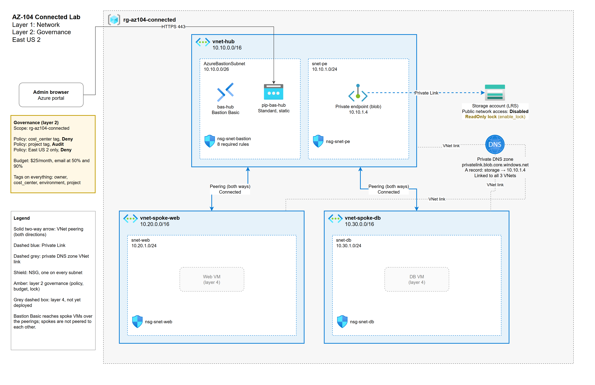

Source: [docs/architecture.drawio](docs/architecture.drawio)

| Component | Name | Address range |
|---|---|---|
| Hub VNet | `vnet-hub` | 10.10.0.0/16 |
| Bastion subnet | `AzureBastionSubnet` | 10.10.0.0/26 |
| Private endpoint subnet | `snet-pe` | 10.10.1.0/24 |
| Web spoke VNet | `vnet-spoke-web` | 10.20.0.0/16 |
| Web subnet | `snet-web` | 10.20.1.0/24 |
| DB spoke VNet | `vnet-spoke-db` | 10.30.0.0/16 |
| DB subnet | `snet-db` | 10.30.1.0/24 |

- **Peering:** hub ↔ web and hub ↔ db, both directions. The spokes are not peered
  to each other, so web-to-db traffic has no direct path.
- **Bastion:** `bas-hub`, Basic SKU, with a Standard static public IP. It is the only
  public entry point, HTTPS 443 only.
- **NSGs:** one on every subnet. `nsg-snet-bastion` carries Microsoft's eight
  required Bastion rules.
- **Storage:** public network access disabled; reachable only through a blob private
  endpoint at 10.10.1.4.
- **Private DNS:** `privatelink.blob.core.windows.net`, linked to all three VNets, so
  the storage account's normal name resolves to its private IP from any VNet.

## Design decisions

| Decision | Chosen | Alternative | Why |
|---|---|---|---|
| Topology | Hub-and-spoke | Flat (one VNet, many subnets) | Shared services (Bastion, private endpoints, later a firewall) live once in the hub. Each spoke is its own boundary, so a compromised web tier has no direct route to the DB spoke. A flat VNet is simpler but every subnet can reach every other by default. |
| Bastion SKU | Basic | Developer | Developer is free but only reaches VMs in its own VNet; it does not work across peering. Basic (~$139/month) reaches VMs in both spokes from a single hub. |
| Storage access | Private endpoint | Service endpoint | A service endpoint keeps the storage account on its public endpoint and only restricts which subnets may call it. A private endpoint gives it a private IP inside the VNet and lets public access be switched off entirely, which is what auditors in regulated industries expect. |
| Traffic filtering | An NSG on every subnet | NSGs only where VMs exist, or on NICs | Every subnet has an explicit, auditable policy from day one, including subnets that are empty today. Subnet-level NSGs are one rule set per tier instead of one per NIC. |

## Layer 2: governance and cost

Layer 1 made the network repeatable. Layer 2 makes the rules around it enforceable:
what every resource must carry, where it may live, what it may cost, and what nobody
may change. All of it is in [governance.tf](governance.tf).

| Control | Scope | Effect | What it does |
|---|---|---|---|
| Required tags | Every resource (Terraform) | Plan fails | A validation on `var.tags` fails the plan unless `owner`, `cost_center`, `environment` and `project` are present and non-empty. |
| Require `cost_center` tag | `rg-az104-connected` | **Deny** | Azure refuses to create or update any taggable resource without it. |
| Require `project` tag | `rg-az104-connected` | **Audit** | The resource is created, but shows as non-compliant. |
| Allowed locations | `rg-az104-connected` | **Deny** | East US 2 only. Global resources such as private DNS zones are exempt. |
| Budget | `rg-az104-connected` | Email | $25 a month, alerts on actual cost at 50% and 90%. |
| Lock | Storage account | ReadOnly | Blocks every write, and every POST, on the storage account. Toggled by `enable_lock`. |

Both tag rules use one custom policy definition with the effect as a parameter,
assigned twice. The built-in "Require a tag on resources" hardcodes Deny, so it can't
serve the Audit assignment. Allowed locations uses the built-in definition.

The budget alert email lives only in `terraform.tfvars`, which is gitignored. The
variable is marked `sensitive`, so the address never appears in plan output either.

### Testing it

Each test ran against the deployed resource group.

| Test | Result |
|---|---|
| Create an NSG without `cost_center` | `RequestDisallowedByPolicy`: "Every resource in this resource group needs a cost_center tag." |
| Create an NSG in West US 2, all tags present | `RequestDisallowedByPolicy`: "Resources in this resource group may only be deployed to: eastus2." |
| Create `nsg-audit-test` with `cost_center` but no `project` | Created. The Audit assignment flags it: 14 of 15 compliant. |
| `az storage account keys list` with the lock on | `ScopeLocked`. Listing keys is a POST, and ReadOnly blocks it. With the lock off, the same command returns `key1` and `key2`. |

The denial messages are the assignments' own `non_compliance_message` text, so the
person who hits the policy is told how to fix it, not just that they failed.

### What the lock broke

The lock did its job, and it also stopped Terraform:

- **`terraform plan` fails while the lock is on.** The azurerm provider calls
  `listKeys` when it reads the storage account, and gets `409 ScopeLocked`. Removing
  the lock means planning with `-refresh=false -var enable_lock=false`.
- **It blocked a change to a different resource.** On the first apply, the lock and a
  tag update on the private endpoint ran in parallel. Updating a private endpoint
  writes a `privateEndpointConnectionProxies` object under the storage account, so the
  lock rejected it. The lock now `depends_on` the private endpoint, so a fresh build
  creates it last. Any later change to the endpoint still needs the lock lifted first.

## What I learned

- **Policy effects decide what kind of control you have.** Deny is a gate: the
  request never lands. Audit is a report: the resource is created and shows up red in
  compliance. Assigning the same rule twice, once with each effect, makes the
  difference visible.
- **A ReadOnly lock means no POST, not just no edits.** Listing keys changes nothing,
  but it's a POST, so the lock blocks it, and so does Terraform's own refresh. A
  lock that's on blocks the tool that put it there.
- **A lock reaches past the resource it sits on.** Locking the storage account
  blocked a tag update on the private endpoint, because the endpoint writes a
  connection object under the storage account. Terraform's parallelism hid that until
  the two resources raced.
- **Tag policy catches resources Azure creates for you.** The private endpoint's NIC
  is created by Azure, copies the endpoint's tags once at creation, and isn't managed
  by Terraform. Adding `cost_center` later reached the endpoint but never the NIC, so
  the NIC is still non-compliant. Deny only blocks new writes, so nothing broke, but
  it shows up in every compliance report.
- **Bastion Developer can't reach VMs across peering.** I started with the free
  Developer tier, then found it only connects to VMs in its own VNet. With Bastion in
  the hub and the VMs in the spokes, that would never work, so I switched to Basic.
- **The Bastion subnet's NSG has a fixed rule set.** If `AzureBastionSubnet` has an
  NSG at all, it must include Microsoft's eight required rules, or the Bastion
  deployment fails. "An NSG on every subnet" still holds; this one just isn't mine to
  design.
- **Peering isn't enough for private endpoints; DNS has to follow.** Without the
  private DNS zone linked to a VNet, VMs there resolve the storage name to its public
  IP and get refused, because public access is disabled, even though peering works.
  Linking the zone to all three VNets is what makes the private endpoint usable from
  the spokes.
- **Masking screenshots took more than blurring IDs.** Hiding the subscription and
  tenant IDs wasn't enough: the Bastion overview showed a public hostname that
  resolves straight to the public IP, and a resource tag showed my name. I now check
  every visible field, not just the obvious ones.

## Cost

East US 2 list prices, 730 hours a month, from the Azure Retail Prices API
(private endpoint rate from Microsoft's published pricing).

| Item | Rate | Per month |
|---|---|---|
| Bastion Basic | $0.19/hour | $138.70 |
| Standard static public IP | $0.005/hour | $3.65 |
| Private endpoint | ~$0.01/hour | ~$7.30 |
| Private DNS zone | $0.50/zone | $0.50 |
| VNets, subnets, NSGs, peering | free to exist | $0 |
| **Total with Bastion** | | **≈ $150** |
| **Total with Bastion off** | | **≈ $8** |

Layer 2 adds nothing to the bill: Azure Policy assignments, budgets, tags and
resource locks are free. During this build Bastion was off (`enable_bastion = false`),
so the lab ran at about $8 a month.

Usage charges come on top and are pennies for a lab: peering at $0.01/GB each way,
private endpoint processing at $0.01/GB, storage by the GB, DNS at $0.40 per
million queries.

### Why Bastion has a toggle

Bastion is over 90% of the bill and charges every hour it exists; it cannot be
stopped, only deleted. `enable_bastion` removes only the Bastion host and its public
IP. The subnet and its NSG stay, so turning Bastion back on changes nothing else in
the network.

```powershell
terraform apply -var enable_bastion=false   # between study sessions
terraform apply                              # back on (default true)
```

## Deploy and destroy

Prerequisites: Terraform 1.9+, Azure CLI, an Azure subscription.

```powershell
az login
cp terraform.tfvars.example terraform.tfvars   # then set subscription_id and budget_alert_emails
terraform init
terraform plan -out lab.tfplan                 # review before anything changes
terraform apply lab.tfplan                     # Bastion takes about 10 minutes
```

Destroy everything this project created. The ReadOnly lock has to come off first, and
with the lock on, Terraform can't refresh the storage account, so that plan skips the
refresh:

```powershell
terraform plan -refresh=false -var enable_lock=false -out unlock.tfplan
terraform apply unlock.tfplan
terraform destroy -var enable_lock=false
```

State is local and gitignored for now; it moves to a remote backend in layer 6.

## Screenshots

Taken after `terraform apply`. Subscription, tenant, account details and public
addresses are masked.

1. **Resource group:** all layer 1 resources in `rg-az104-connected`
   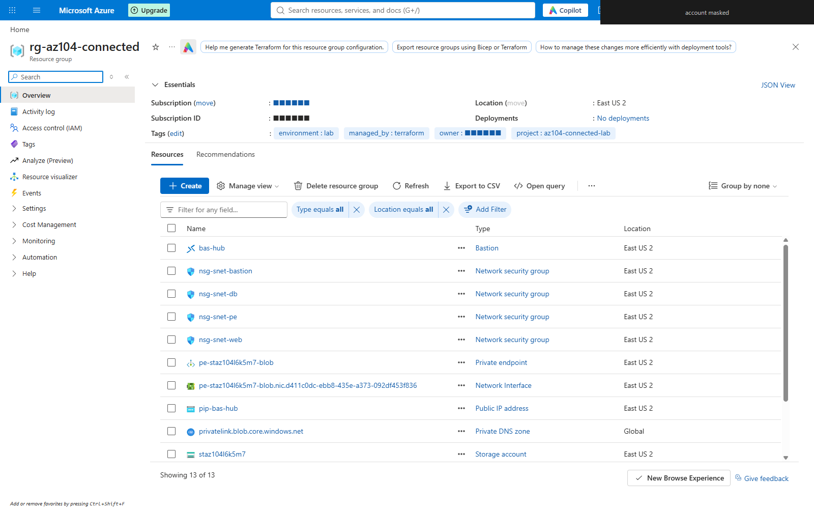
2. **Peerings:** both hub peerings Connected and Fully Synchronized
   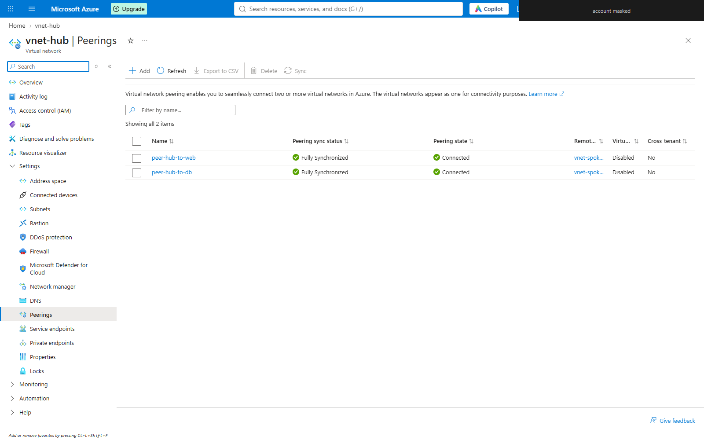
3. **Bastion:** Basic SKU, provisioned in `AzureBastionSubnet`
   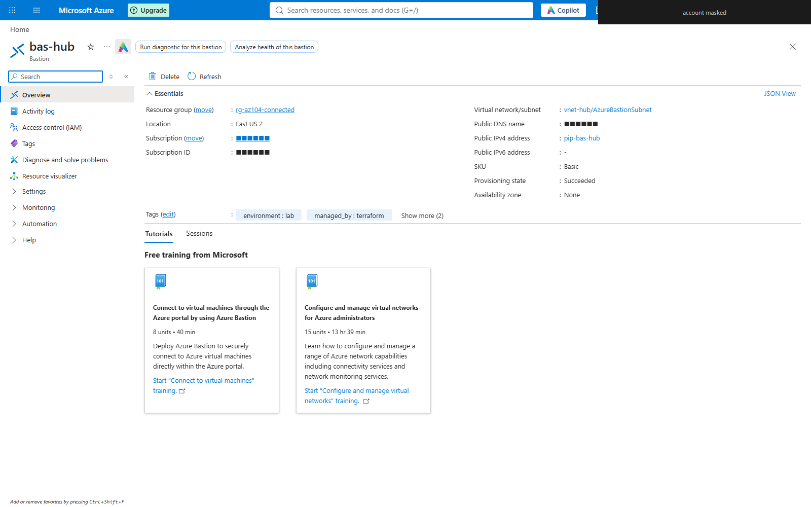
4. **Private endpoint:** connected to the storage account's blob service, Approved
   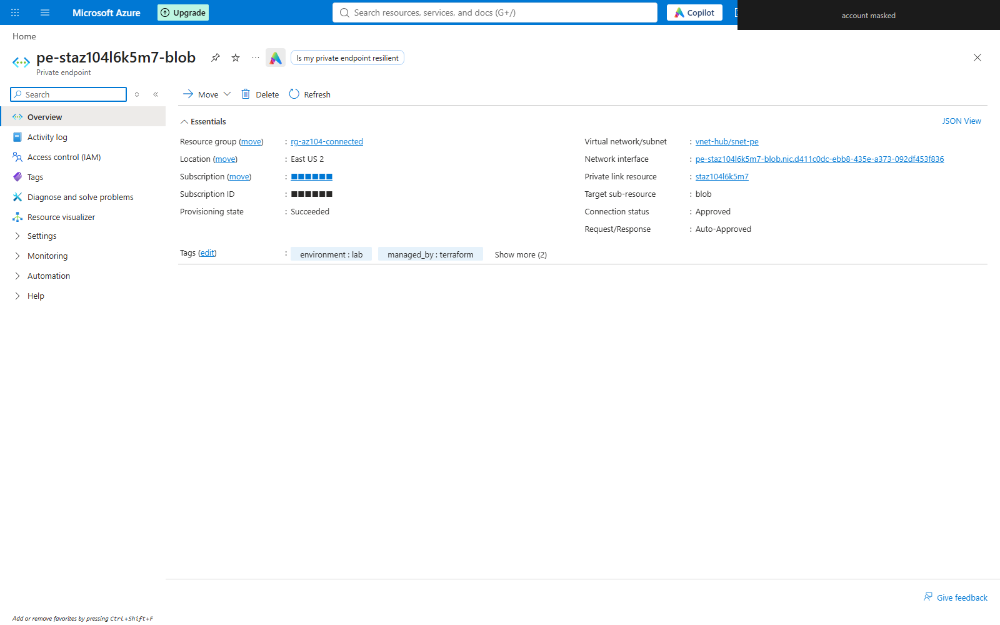
5. **Private endpoint DNS:** the storage name resolves to 10.10.1.4 through the private zone
   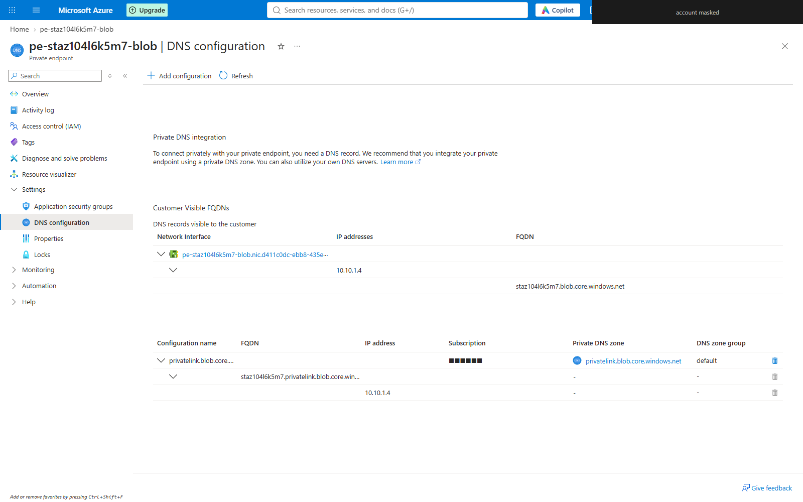
6. **Network Watcher topology:** the hub, both spokes and Bastion
   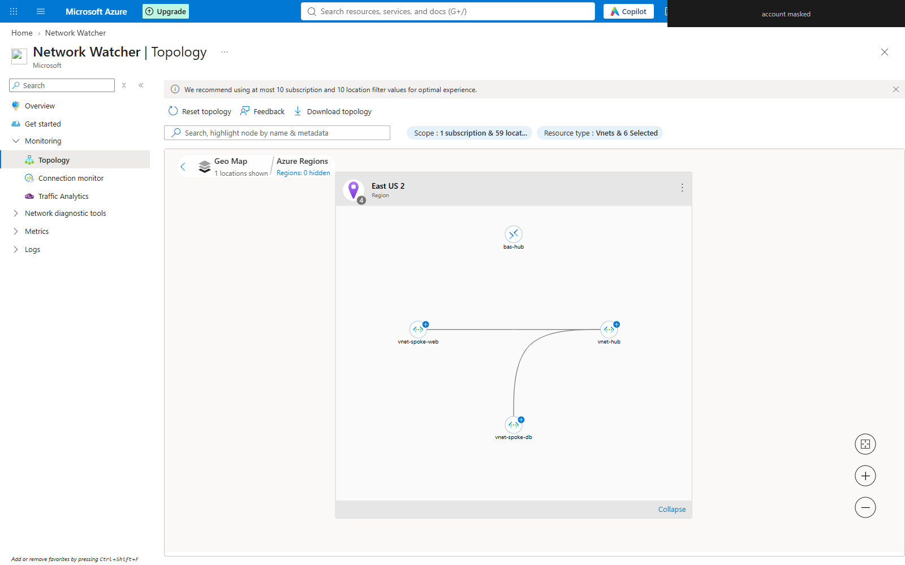

Layer 2, taken after the governance apply:

7. **Policy compliance at the resource group:** the three layer 2 assignments.
   cost_center shows 2 non-compliant: the private endpoint and its NIC. The ReadOnly
   lock blocked the private endpoint's tag update, and the compliance scan ran before
   the relock apply fixed it. The NIC stays non-compliant (see What I learned).
   "ASC Default" is Defender for Cloud's built-in assignment, inherited from the
   subscription; Terraform did not create it.
   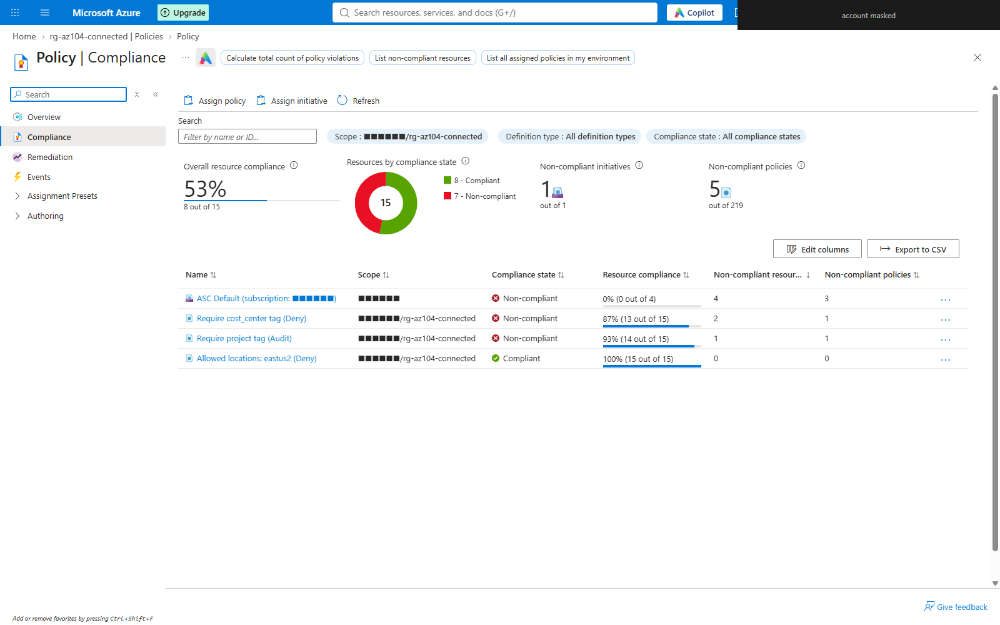
8. **Audit in action:** `nsg-audit-test` has no `project` tag. It was created anyway
   and is flagged non-compliant, 14 of 15 compliant.
   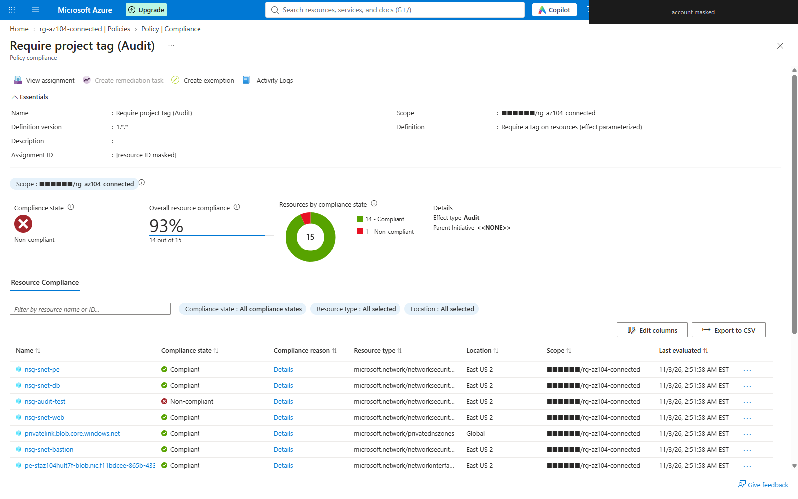
9. **Budget:** $25 a month, resetting monthly, with alerts on actual cost at 50% and
   90%. The recipient address is masked.
   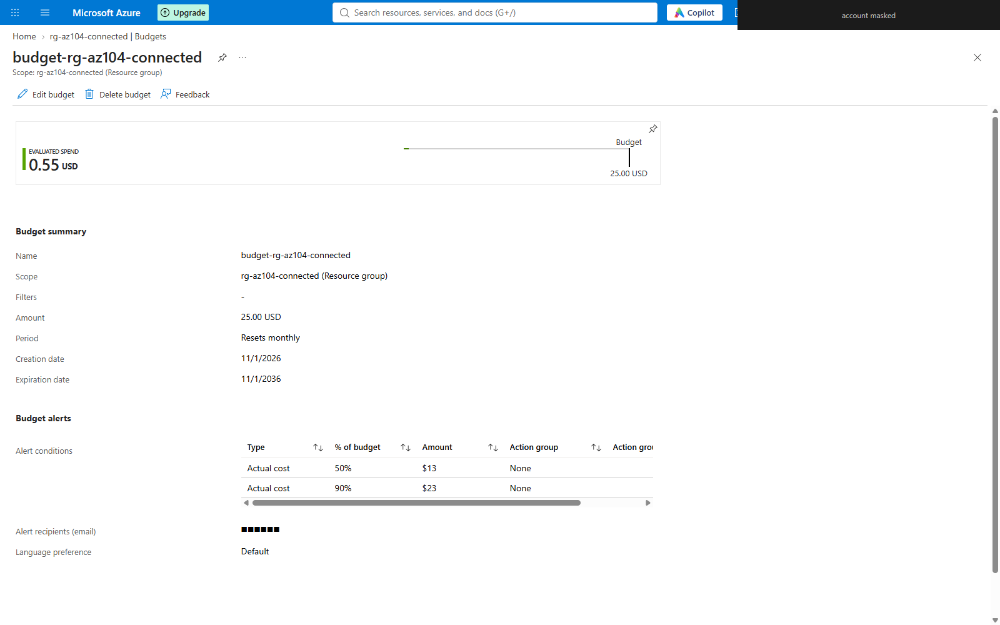
10. **Lock:** the ReadOnly lock on the storage account.
    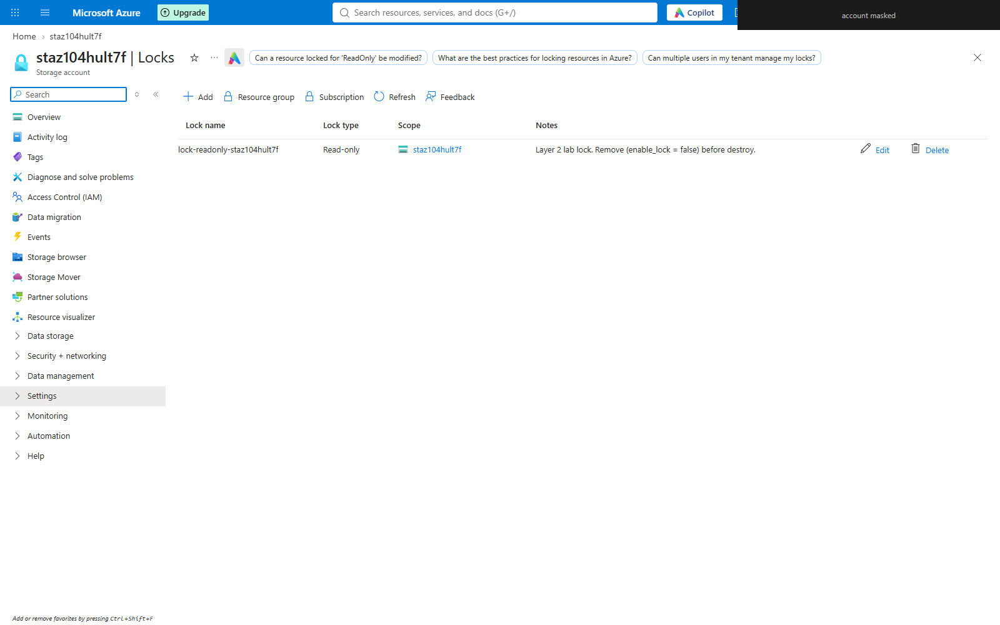

The full apply log is in [docs/apply-output-layer1.txt](docs/apply-output-layer1.txt)
(subscription ID redacted).

## What I'd change at production scale

- **Inspect traffic in the hub.** Add Azure Firewall with route tables that force
  spoke traffic through it, so spoke-to-spoke and internet-bound traffic is logged
  and filtered.
- **Separate subscriptions.** Put the hub and each spoke in its own subscription
  under an Azure Landing Zone management group structure, for blast radius and
  billing.
- **Enforce, don't just configure.** Assign policy at a management group, not a
  resource group, so new subscriptions inherit it. Add rules that deny public IPs on
  NICs and require private endpoints for PaaS, and use Modify policies to inherit tags
  from the resource group, so platform-created resources like the private endpoint's
  NIC don't fall out of compliance.
- **Budgets that act.** Route budget alerts to an action group, not just email, so
  crossing a threshold can page someone or trigger automation.
- **Remote state and a pipeline.** State in a locked storage backend; changes only
  through GitHub Actions with OIDC, plan review and manual approval (layer 6).
- **Hybrid connectivity.** ExpressRoute or VPN gateway in the hub, with Azure DNS
  Private Resolver so on-premises can resolve private endpoint names.
- **Resilience and protection.** Zone-redundant storage, DDoS Network Protection on
  the hub, and Bastion Standard or Premium for native-client access and session
  recording.
- **Visibility.** VNet flow logs and Traffic Analytics into Log Analytics (layer 5).

## Three explanations

**For engineers.** A Terraform-built hub-and-spoke in East US 2: a hub VNet carrying
Bastion Basic and a blob private endpoint, two spokes peered to the hub in both
directions but not to each other, an NSG on every subnet, and a private DNS zone
linked to all three VNets. The storage account has public network access disabled.
Bastion sits behind a boolean so the expensive part can be removed without touching
the rest of the network. Layer 2 adds resource-group policy (cost_center tag Deny,
project tag Audit, East US 2 only Deny), a $25 monthly budget with 50% and 90% alerts,
and a toggleable ReadOnly lock on the storage account.

**For managers.** The network a regulated workload would sit on is now code. It
deploys the same way every time, every change is reviewed before it happens, and the
whole environment can be torn down in minutes. It costs about $150 a month while
running and about $8 with remote access switched off between sessions. Rules are now
enforced, not just written down: untagged or out-of-region resources are refused, and
a budget emails before spend gets out of hand.

**For executives.** Servers and data in this design are unreachable from the
internet. The only door is a managed Microsoft service, and the data store
has no public address at all. Because the build is automated, it can be reproduced,
audited and rebuilt on demand, which is the evidence regulators ask for.
